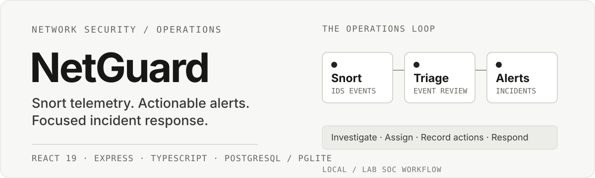
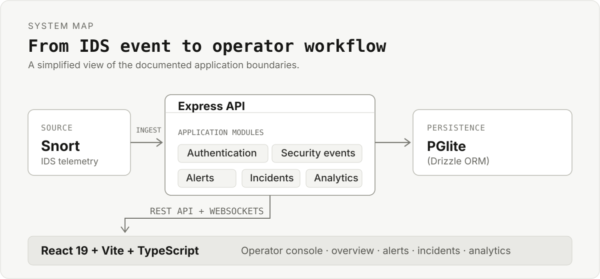

<p align="center">
  
</p>

<h1 style="font-weight:bold">Net Guard</h1>

<p align="center"><a  href=#>Deployed Link</a></p>
<p align="center">
  
</p>

<p align="center">
  <strong>Network Security Management · Alert Triage · Incident Response</strong>
</p>

NetGuard is a web-based security operations console for Snort telemetry. It ingests IDS events, correlates them into actionable alerts and incidents, and gives operators a focused interface for investigation, triage, and incident response.

> [!IMPORTANT]
> This project is designed for a local or lab security operations workflow. It is not a replacement for a full enterprise SIEM stack, but it is a practical platform for understanding alert handling, incident workflows, and telemetry exploration.

## Overview

NetGuard combines a TypeScript-based Express backend with a React frontend to provide a complete SOC-style workflow:

- Snort event ingestion via authenticated API or ingest key
- Security event exploration with filtering and raw payload inspection
- Alert creation and lifecycle management
- Incident grouping and ownership tracking
- Investigation timeline with notes, actions, and containment records
- Live updates over WebSockets
- Analytics summaries for MTTD and operational trends
- Swagger/OpenAPI documentation

## Key capabilities

- Event ingestion API for IDS telemetry
- Role-based access control for admin, analyst, and viewer users
- Persistent local database support via PGlite, with PostgreSQL compatibility for production deployment
- Dashboard views for overview, alerts, incidents, and analytics
- Real-time event updates and reconnect-safe client synchronization
- API-first design with schema validation using Zod

## Architecture

<p align="center">


</p>
NetGuard follows a simple layered design:

- Frontend: React 19 + Vite + TypeScript
- Backend: Express + TypeScript
- Data layer: Drizzle ORM + PostgreSQL / PGlite
- Auth: JWT + bcrypt
- Real-time: WebSocket gateway
- Docs: Swagger UI / OpenAPI

```text
React SPA
  └─ NetGuard UI
       │
       v
Express API
  ├─ Authentication
  ├─ Security events
  ├─ Alerts
  ├─ Incidents
  └─ Analytics
       │
       v
Database (PGlite or PostgreSQL)
```

## Repository structure

```text
.
├── docs/                           # Project documentation and design notes
├── src/
│   ├── components/                 # React UI and feature modules
│   ├── context/                    # App state providers
│   ├── db/                         # Drizzle schema and initialization
│   ├── server/                    # API controllers, services, and middleware
│   ├── types/                     # Shared TypeScript types
│   ├── App.tsx                    # Application entry and tab routing
│   ├── index.css                  # Global styles
│   └── main.tsx                   # React bootstrap
├── drizzle.config.ts              # Drizzle configuration
├── index.html                     # Vite HTML entry
├── metadata.json                  # Project metadata
├── package.json                   # Scripts and package dependencies
├── server.ts                      # Express server start-up and routing
├── tsconfig.json                  # TypeScript configuration
├── vite.config.ts                 # Vite configuration
├── bun.lock                       # Bun lockfile
├── .gitignore                    # Git ignores
├── MASTER.md                      # Architecture and operations specification
└── README.md                      # Project overview and setup guide
```

## Quick start

### Prerequisites

- Node.js 22+
- npm or bun
- A modern browser

### Install and run

```bash
# Install dependencies
npm install
# or
bun install

# Start the application in development mode
npm run dev
# or
bun run dev
```

The development command starts the Express server and serves the Vite frontend. The API documentation is available at `http://localhost:3000/api/docs` when the application is running on its default local port.

### Build for production

```bash
npm run build
npm run start
```

## Local data and configuration

NetGuard uses **PGlite** by default, so a local run does not require a separate PostgreSQL server or environment variables. Persistent local data is stored under:

```text
.data/netguard_pg
```

For a PostgreSQL-backed deployment, configure the database connection through environment variables before starting the application. The exact deployment values depend on your environment.

## First-run administrator

On first startup, NetGuard creates an administrator account if one does not already exist:

| Field | Local demo value |
| --- | --- |
| Email | `lead_admin@netguard.local` |
| Password | `SecurePassword123!` |


> [!WARNING]
> These are documented local-demo credentials. Change the password immediately, rotate any exposed secrets, and do not use the default credentials in a shared or production environment.

## Send Snort events

The ingestion endpoint accepts a single event or a batch of events:

```http
POST /api/events/ingest
```

A single-event request body looks like this:

```json
{
  "timestamp": "2026-11-01T12:00:00.000Z",
  "generatorId": 1,
  "signatureId": 2001219,
  "signatureRevision": 4,
  "signatureMessage": "ET SCAN Potential SSH Scan OUTBOUND",
  "classification": "Attempted Information Leak",
  "priority": 1,
  "protocol": "TCP",
  "sourceIp": "192.168.1.105",
  "sourcePort": 49152,
  "destinationIp": "10.0.0.1",
  "destinationPort": 22,
  "rawPayload": "SSH-2.0-OpenSSH_8.2p1"
}
```

Authenticate the request using either:

- `Authorization: Bearer <token>` with a valid admin or analyst JWT, or
- `X-Ingest-Key: <key>` matching the configured `INGEST_API_KEY`.

## API surface

The main API routes are grouped under `/api`:

| Route | Purpose |
| --- | --- |
| `/api/auth` | Authentication |
| `/api/users` | User management |
| `/api/events` | Security event ingestion and exploration |
| `/api/alerts` | Alert lifecycle management |
| `/api/incidents` | Incident coordination and investigation |
| `/api/analytics` | Operational analytics |
| `/api/docs` | Swagger / OpenAPI documentation |

## Repository layout

```text
.
├── assets/
│   └── readme/              # README SVG artwork
├── docs/                    # Project documentation and design notes
├── src/
│   ├── components/          # React UI and feature modules
│   ├── context/             # App state providers
│   ├── db/                   # Drizzle schema and initialization
│   ├── server/               # API controllers, services and middleware
│   ├── types/                # Shared TypeScript types
│   ├── App.tsx               # Application entry and tab routing
│   ├── index.css             # Global styles
│   └── main.tsx              # React bootstrap
├── drizzle.config.ts
├── index.html
├── metadata.json
├── package.json
├── server.ts                 # Express server startup and routing
├── tsconfig.json
├── vite.config.ts
├── bun.lock
└── MASTER.md                 # Architecture and operations specification
```

## Security notes

- JWT signing uses a configurable secret.
- Passwords are hashed with bcrypt.
- Automated ingestion can use a dedicated API key.
- Rotate default credentials and secrets before exposing the application beyond a local lab.
- Use environment-based configuration for non-local deployments.

---

<p align="center">
  <sub>Built for practical IDS telemetry exploration and controlled incident workflows.</sub>
</p>
